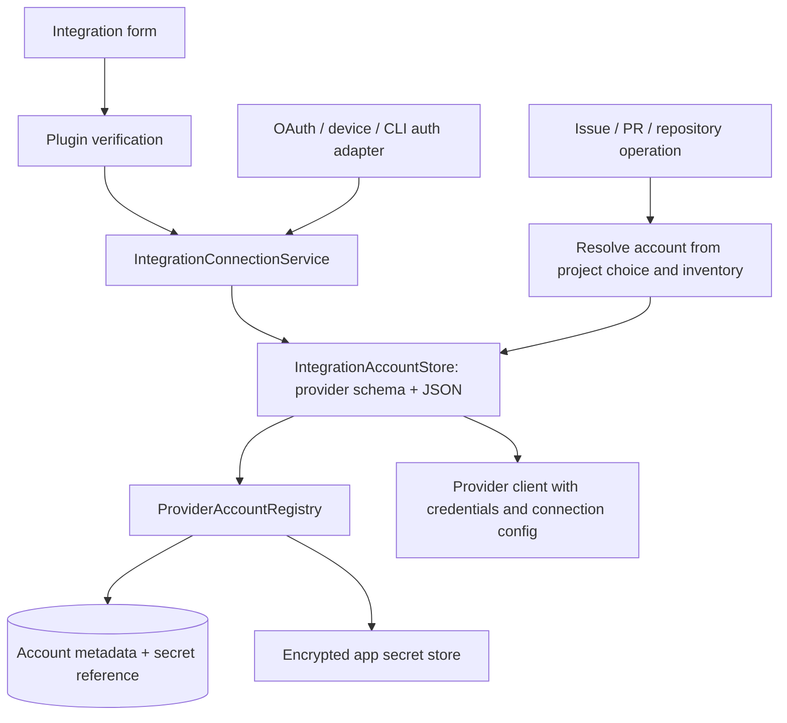

# Integration, Issue, Pull-Request, And Repository Plugins

Integration plugins in `packages/plugins/src/integrations/` own service metadata, auth
method descriptors, credential schemas, and credential verification. Issue plugins in
`packages/plugins/src/issues/` reference an integration by `integrationId` and own issue
operations. Pull-request plugins in `packages/plugins/src/pull-requests/` do the same for PR/MR
operations. Repository plugins in `packages/plugins/src/repository/` own hosted-repository
operations and host detection. GitHub follows the same plugin contracts as the other
integrations.

## Issue Context During Task Creation

Task creation retrieves details for providers that support issue context before enabling
creation with the default context setting. Loading and errors are visible; errors offer a
retry. Changing or clearing the selection discards stale query results. Enrichment preserves
edited context and a removed issue mention. Turning off the default issue-context setting
skips this retrieval.

## Authentication Contract

`capabilities.auth` is a serializable descriptor for connection UI: form fields, OAuth,
device flow, CLI import, and whether an account label is required. Executable code belongs
in `behavior.auth`, which must register both:

- `credentialsSchema`: the provider's Zod parser for its JSON credential payload. Use the
  same schema in the provider's client factory and verifier. Parsing is local validation
  and normalization; it does not prove that a credential is accepted by the remote API.
- `verify`: checks credentials against the provider and returns canonical credentials on
  success, together with optional stable account identity and display metadata. Persist
  the returned credentials, never fall back to the submitted form values.

Three behaviors are optional:

- `credentialsFromOAuthToken({ accessToken, expiresAt?, host })`: required when the descriptor
  declares an `oauth` method (sign-in through the Emdash auth server). It maps an access token
  issued by the server into the provider's credential shape. The server keeps the refresh token.
- `startDeviceAuthorization`: required when the descriptor declares an `oauth-device` method.
  It returns the user code, verification URL, and lifetime, plus `complete(signal)`, which polls
  until the user approves and resolves with credentials for `verify`. Build it with
  `startDeviceAuthorizationSession` from `integrations/helpers/oauth-device.ts` (RFC 8628);
  every request times out after 30 seconds, and polling retries network failures and 5xx
  responses until the code expires.
- `refreshCredentials(host, credentials, now)`: renews credentials the integration issued itself
  (e.g. by device sign-in) with their refresh token. It returns replacement credentials, or
  `undefined` when these credentials cannot be refreshed.

Credentials that expire carry `expiresAt` (epoch milliseconds); `credentialsExpireAt` reads it.

### Sign-in through the Emdash auth server (`oauth`)

The desktop runs the browser PKCE flow against the auth server for any integration whose
descriptor declares `{ kind: 'oauth', providerId }`: it signs in to Emdash with the provider, or,
when already signed in, links another provider account (`account-link/start?provider_id=...`).
The exchange returns the provider access token, its expiry, and the account identity.
`IntegrationOAuthTokens` (`core/features/integrations/node/integration-oauth-tokens.ts`) maps the
token with `credentialsFromOAuthToken`, verifies it with the plugin's `verify` (so an account has
the same identity whichever method connected it), checks that it belongs to the account the
server named, and saves it through `connectVerified` with credential source `emdash_oauth`.
GitHub and GitLab use this path; there is no per-provider adapter.

### Renewing expiring credentials

`IntegrationAccountStore.getAccount` is the only credential read path. When stored credentials
expire within five minutes (`CREDENTIAL_RENEWAL_SKEW_MS`), it renews them before returning the
account. The store decides when; the credential source decides how:

- `emdash_oauth`: the renewer registered with `setRenewer` asks the auth server for the linked
  account's current token (`POST /api/v1/auth/electron/provider-token` with the Emdash session).
  The server refreshes tokens that expire within ten minutes, so it always returns a token that
  outlives the desktop window. Every client of an Emdash account shares that token, and GitLab
  revokes the previous token pair on refresh.
- any other source: the integration's `refreshCredentials`, if it has one.
- no `expiresAt` (access tokens, GitHub OAuth tokens): never renewed.

Renewals are serialized per account and the new credentials are written (secret only; metadata
unchanged) before they are returned, because rotating refresh tokens are single-use. A failed
renewal logs and returns the stored credentials with `renewalError`; the provider's 401 then
fails the API call, and the connection status shows `renewalError` (for example, "Sign in to
Emdash to keep GitLab connected."). A renewal the provider or server rejected (`auth_failed`,
or an account no longer linked to the Emdash account) is not retried until the credentials
change, for example on reconnect. Other failures, including a missing or expired Emdash session,
are retried on the next read. A session the server rejects is cleared, so later reads fail
without a request until the user signs in again; a response for an older session never clears a
newer one. Renewed credentials that fail to save are kept in memory, returned, and written again
on the next read, since the provider has already invalidated the stored refresh token. A renewal
is saved only if the stored credentials are still the ones it replaced, and `upsertAccount` waits
for an in-flight renewal of the same account, so a disconnect or reconnect during a renewal is
never undone.

### Device sign-in (`oauth-device`)

The desktop drives device sign-in for any integration through the integrations Wire API:
`startDeviceFlow` returns the code, `completeDeviceFlow` resolves once the user approves,
denies, or the code expires, then verifies and saves the account with credential source
`device_flow`, and `cancelDeviceFlow` aborts it; a flow cancelled before the save saves nothing.
Each flow completes at most once. `completeDeviceFlow` waits for the user, so the renderer calls
it with a deadline longer than the code's lifetime; cancelling the Wire call cancels the flow.
The renderer uses `integrationDeviceFlowModal`. It shows the code, opens the verification URL
(with the code pre-filled when the provider supplies one, otherwise after copying the code)
after a three-second countdown, and supports ⌘C to copy and Enter or ⌘R to open. Reconnecting
an account passes its `accountId`; signing in as a different identity fails.

### Connection UI

`StandardIntegrationAuth` (`core/features/integrations/contributions/browser/standard-integration-auth.tsx`)
offers the declared `oauth`, `oauth-device`, and `form` methods. With an Emdash account, signing
in through Emdash replaces device sign-in, except when reconnecting an account. Integrations
register it, or a wrapper that adds provider-specific methods (GitHub adds CLI import), in
`core/manifests/browser/integration-auth-contributions.ts`.

Credentials include connection configuration needed to create a client, such as GitHub's
`apiBaseUrl`, Jira's `siteUrl`, or Plane's workspace slug. The schema remains backend-only;
it is not embedded in the renderer descriptor. Register schemas for every integration,
including GitHub. GitHub additionally exposes its credential schema and TypeScript type
through `@emdash/plugins/integrations/github` for GitHub-specific client consumers.

## Identity And Host Ownership

`VerifiedAccountIdentity.id` identifies the provider account within `scope`; the desktop
currently falls back to `host`, then integration ID, when no explicit scope is supplied.
Preserve existing identity keys when changing schemas. `login`, avatar, and display names
are optional presentation data. Do not invent a login from a display name, workspace name,
or ID. Providers without a stable remote identity may omit `account`; the desktop owns
their local account ID and user label.

The desktop owns account selection, deduplication, project preferences, persistence,
secret references, and credential-format migrations. Public host interfaces live in
`apps/emdash-desktop/src/core/features/integrations/api/node/integration-accounts.ts`:
credential consumers use `IntegrationAccountReader`; authentication adapters complete
verified connections through `IntegrationConnections`.

`IntegrationConnectionService` verifies submitted credentials through the plugin, then
uses the same completion path as trusted OAuth, device-flow, and CLI authentication
adapters. That path owns identity matching, reconnect checks, labels, and persistence.
GitHub's authentication adapters translate their verified identity and credentials into
this contract; they do not write account records themselves. Migration-only imports use
the durable import mechanism so completion and legacy-source cleanup remain retryable.

`IntegrationAccountStore` validates credentials with the registered provider schema on
both reads and writes. It stores the normalized record as JSON through
`ProviderAccountRegistry`. The registry owns account rows, defaults, and opaque secret
references. Its secret-store interface is still string-based: the string is the JSON
document, encrypted by the app secret backend. Account metadata contains no token.

At service startup, `migrateGitHubJsonCredentials` wraps existing raw GitHub tokens as
`{ accessToken, apiBaseUrl }` before account consumers become available. The migration is
offline and idempotent, retains account IDs/defaults/metadata/secret references, and can
retry failed writes. It never interprets an existing JSON document as a token. The older
single-token GitHub importer also writes the JSON representation.



The integrations Wire API separates `listProviders` (available providers described by
`IntegrationProviderDescriptor`, including auth methods and `issueCapabilities`) from
`listAccounts` (saved account summaries grouped by provider ID). Account inventory does
not verify credentials; live connection checks belong to a separate operation.

The renderer observes one account query via `useAccounts()`, `useAccounts(providerId)`,
or `useAccounts(providerId, typeGuard)`. Provider authentication actions are separate
from account inventory; there is no GitHub-specific account query/cache.

The integrations event stream owns `accounts-changed` notifications for successful
connections, reconnects, removals, default changes, and startup reconciliation. The
renderer refreshes shared account inventory and dependent issue queries through
`useIntegrationAccountEvents`, including after a stream gap. GitHub events carry only
authentication progress and notifications. `IntegrationConnectionService` is the sole
owner of `integration_connected` telemetry; authentication adapters do not count the
same connection again.

Project account selection has one provider-parameterized seam: `useProjectAccount` in
browser consumers and `ProjectIntegrationAccountResolver` in node consumers share
`resolveProjectAccount`. Callers identify the provider and choose an explicit repository
context: project context uses the effective base remote; resource context uses the supplied
repository URL. Non-repository integrations omit that context and infer the provider default.
Pins and explicit disable remain fail-closed, and resolutions include the inventory and
account-context key they observed. Git/placement `EffectiveSettings` contains no account
fields and does not load account inventory; worktree previews remain available while
accounts are loading or unavailable.

Account presentation uses `ProviderAccountLabel` and the concrete-account picker
`ProviderAccountSelect` from the provider-accounts browser primitives. They consume
`ProviderAccountSummary` display fields; callers supply the provider name and icon.
The registry assigns a persistent fallback name such as `Account 1` when an account has
no user label, provider display name, or login. It fills missing names on legacy reads
and assigns new names in the account-write transaction. Reconnects retain those names;
real display metadata takes precedence, and sorting or default changes never renumber them.
`createRequiredProviderAccountSelectState` supplies default-first selection for forms
that require an account. Project settings keep their explicit-disable, reset, and
unavailable-pin policy in the shared project account resolver.

The shared `identityStripView` derives account override, resolved identity, and unavailable
states for any provider. `ProviderIdentityStrip` renders that state, account selection,
provenance, and remember-account controls using generic account summaries. Callers supply
the provider name/icon and workflow wording, and own action blocking and persistence.
Project preferences are written through `ProjectSettingsStore.save`.
Create PR blocks submission until its selected account is saved successfully; Add Remote
passes its per-action account explicitly even if remembering the preference fails.

Every connection entry point opens `integrationSetupModal`. It renders the plugin's
declared form fields or a provider-owned auth UI contribution registered in
`src/core/manifests/browser/integration-auth-contributions.ts`. GitHub contributes its
OAuth, device-flow, and CLI acquisition UI through this seam. Those mechanisms remain
provider-specific; successful authentication enters the common connection service.
Reconnect availability follows the supported auth methods and contribution capabilities.
Project account selectors share the same inventory and repository-host matching policy
for repository-scoped integrations.

Issue behaviors receive only `{ credentials, log }` through
`ConnectedIntegrationHostContext`. The desktop resolves the account before invoking the
plugin and attaches account/source identity to results outside the plugin. A verified
identity identifies a connection; it does not establish repository compatibility or API
authorization for every operation.

All issue providers, including GitHub, are assembled with `createPluginIssueProvider`.
Repository-scoped plugins declare `requiredInputs: ['repositoryUrl']`. The desktop
normalizes complete repository URLs and SSH remotes, then uses their host for common
account inference. Hostless shorthand such as `owner/repo` is rejected before credential
access; callers must resolve it using explicit repository context. The provider client
validates the resource against its credential endpoint before requests. Project
disable/dangling-pin states and stale account-context checks fail closed. A linked issue
retains its captured source account when the project's preferred account changes.

Other GitHub features first select an account through the shared resolution policy.
Repository operations resolve against the common inventory; PR and Git operations use
the shared project/operation resolution described above. They then call
`readGitHubCredentials(accountId, expectedHost)`, created by `createGitHubCredentialReader`,
to read typed credentials from `IntegrationAccountReader` and validate the endpoint.
The reader requires an explicit account ID and never infers or switches accounts.
A missing/unusable record fails closed; an exact-ID metadata lookup distinguishes a
removed account from missing credentials. Repository operations read hosts from account
metadata, never from the account ID. Octokit construction and PR-worker auth use the
stored `apiBaseUrl`; Git's credential sink extracts the token from the same credentials.

GitHub's hosted-repository Wire procedures (`getOwners`, `createRepository`, `deleteRepository`)
select an account this way and call the GitHub repository plugin. Create Repository and Add Remote
offer GitHub and GitLab.

Repository creation carries the selected provider/account reference into the clone job.
Local HTTPS clone credential channels bind to that exact GitHub or GitLab account, including when it was
initially inferred; later default changes never switch an in-flight clone's identity.
Removal or a host mismatch fails closed. Project-session channels continue to resolve
the current project choice for each request. Remote-host and SSH clones retain native
Git authentication because the desktop credential channel is local-only.

New project registration accepts an `initialIntegrationAccounts` map and commits it in
the same desktop transaction as the Project and Repository association. A settings-write
failure rolls back registration and surfaces as a creation failure; there is no separate
best-effort renderer save that can lose the intended account pin.

## Pull-Request Plugins

A pull-request plugin's behavior is a stateful factory, `createClient(host)`, returning a
`PullRequestClient`. Unlike stateless issue behaviors, a client owns its platform's request lanes
and rate model, so the pull-requests worker creates one per integration and reuses it. Canonical
PR schemas and types live in `@emdash/plugins/pull-requests/schemas` and
`@emdash/plugins/pull-requests/types`; the app imports them from there.

Clients run in the pull-requests worker, not main. `PullRequestHostContext.resolveCredentials`
calls `gitPlatformAuthContract.resolveAuth` per repository with the client's `integrationId`; the
desktop resolves the project's account for that integration and returns
`{ integrationId, accountId, credentials }`, where `credentials` is the integration's
stored record. The client narrows it with its integration's credential reader and fails closed on
a malformed record. `PullRequestEngine` asks the desktop which integration serves a repository
(`gitPlatformAuthContract.resolveIntegration`, answered by the repository router), picks that
integration's client from `pullRequestsPluginRegistry`, and refuses credentials resolved for a
different integration. The desktop registers a remote for PR sync only when it routes to an
integration with a pull-requests plugin.

PR errors are provider-agnostic (`auth_required`, `account_not_found`, `rate_limited`, and so on).
The plugin error schema covers provider operations and credential failures. The desktop
pull-requests service composes it with its own cache, repository-registration, and dispatch
errors in `api/errors.ts`; desktop contracts and consumers use that composed schema and type.
Variants that call for user action on an account carry the `integrationId` to reconnect; the
sync skips without retrying on identity failures, and the PR selector opens that integration's
setup.

## Repository Plugins

A repository plugin implements hosted-repository operations for one integration. The contract
is `IRepositoryBehavior` in `packages/plugins/src/repository/capabilities/repository.ts`; data
and error types are in `types.ts` beside it.

- `listOwners`, `createRepository`, and `deleteRepository` are required. They are stateless and
  receive `ConnectedIntegrationHostContext`; the desktop selects the account before calling.
  `deleteRepository` is used to roll back a repository created for a project whose creation
  then failed.
- Failures are `IntegrationError`. The `message` is shown to the user.
- `probeHost(host, hostname)` is optional. It makes an unauthenticated request to `hostname`
  and answers whether the host runs this integration's platform: success, `unsupported_host`
  (the host answered and is not this platform), or `host_unreachable` / `host_error` (no
  answer, so no verdict).
- The descriptor's `knownHosts` lists hostnames that always belong to this integration, such as
  a hosted service's public domain.

GitLab declares `gitlab.com` and has no host probe. A self-hosted GitLab remote routes through a
connected account for its host. GitLab owner listings include the user's namespace and groups where
their role permits project creation; existing nested groups use their full path as the owner. Emdash
creates projects in those groups but does not create subgroups. Repository
creation resolves that owner's namespace ID before calling GitLab, and deletion uses the full path.
Create Repository lists GitLab user and group owners for the selected account. It clones the
created project over HTTPS with the selected account's token. GitLab-facing UI calls issues
"work items".
Add Remote creates an empty GitHub or GitLab repository before publishing the current branch.
The selected account is used for creation, fetch, and publish in that action. Create Repository
initializes a README before cloning.
GitLab continues to use the issues plugin and GitLab Issues API. The current GitLab issues plugin
lists and searches work items. Work-item writes are not yet implemented in Emdash.

The GitLab pull-requests plugin supports merge request inventory, details, approvals, pipeline
jobs, discussions, files, creation, merge, and mark-ready actions. GitLab-facing text uses
MR / merge request; GitHub-facing text retains PR / pull request.

GitLab credentials are either an access token (`{ instanceUrl, apiToken }`, sent as
`PRIVATE-TOKEN`) or an OAuth access token (`{ instanceUrl, accessToken, refreshToken?,
expiresAt? }`, sent as `Authorization: Bearer`). OAuth is gitlab.com only. Signing in through
Emdash is the primary method: the auth server's GitLab application issues the token and keeps
the refresh token. Device sign-in uses emdash's public OAuth application (scopes `api read_user`,
client ID in the GitLab plugin) and stores the refresh token on the desktop; GitLab rotates it on
every use. Access tokens last two hours and are renewed as described above. Refresh tokens are
only ever sent to `https://gitlab.com`. Git over HTTPS sends OAuth tokens with the username
`oauth2`. Self-hosted instances use an access token.

A legacy personal token with `read_api` supports reads; writes require `api` and the project
permissions for the operation. A forbidden write prompts the user to reconnect with an
`api`-scoped token. Project rules still apply. GitLab does not offer the GitHub bypass action.
The rebase strategy requires a project configured for fast-forward merging and a source branch
that can fast-forward; other project merge methods return `merge_failed`. Draft creation uses
the `Draft:` title prefix; mark-ready removes the draft prefix through the MR update endpoint
and verifies the returned draft state.

GitLab uses a separate REST request lane and token-bucket gate from GitHub. Requests reject
redirects and pagination URLs outside the configured instance API. Inventory uses the MR list
endpoint, ordered by `updated_at`, and incremental history supplies `updated_after`. Pagination
follows the server's next link or page header; the MR endpoint returns page-based links.
Inventory resolves source project URLs for fork association, sharing a lookup for MRs from the
same source project on a page. Detail consumers fetch approvals, commits, and diffs; pipeline jobs and discussions have separate
reads. Label details retain colors, and detail reads resolve fork source projects.
A deleted or inaccessible source project leaves `headRepositoryUrl` empty; the MR remains
readable but cannot match a task by source repository and branch. Other source lookup failures
remain refresh errors.

`PullRequestPage.detailOnlyFields` declares fields absent from inventory. Inventory preserves
cached values for omitted detail fields. An unchanged head and update timestamp preserve their
freshness within the current account generation. Changed inventory or a worker restart
invalidates detail freshness; incomplete observations cannot mark details fresh.
GitHub omits this optional declaration because its inventory query supplies complete metadata.
`PullRequestFile.additions` and `deletions` are nullable when the provider omits a file diff.
GitLab size limits produce unknown counts and no patch, rather than zero counts. Complete diffs
retain numeric counts. GitHub file responses remain numeric. No database schema change is required.
For an MR associated with an existing task, Update now fetches the source branch for same-project
MRs and `refs/merge-requests/<iid>/head` for forks. Create Task and Review in Task accept GitLab
MRs through the shared selector. Request-based workspace configs carry an optional provider;
omitted providers use GitHub. Same-project checkouts track the source branch, while fork
checkouts use `mr/<iid>/<branch>` and the MR head ref from the target remote. A new task branch
based on an MR also fetches the MR head ref. The MR URL is retained as the workspace breadcrumb.
Missing-commit recovery in file review passes the MR head ref through the review-fetch input to
the configured target remote, including for fork MRs.

Focused checks from the repository root:

```bash
pnpm --filter @emdash/plugins test -- src/pull-requests
pnpm --filter @emdash/emdash-desktop test -- --project main-db src/core/services/pull-requests/node
pnpm --filter @emdash/emdash-desktop test -- --project node pr-sync-status-card.test.ts merge-ui-state.test.ts
```

These tests use mocked API responses and temporary SQLite stores. They do not establish live
GitLab token-scope or write behavior.

### GitLab token permissions

For a legacy **personal access token**, these are the minimum scopes for each operation. Emdash
verifies a connection with `GET /user`, so a token used only for Git over HTTPS also needs
`read_user` to connect in Emdash.

| Operation | Minimum personal-token scopes |
| --- | --- |
| Clone or pull a repository over HTTPS | `read_user` + `read_repository` |
| Push a repository over HTTPS | `read_user` + `write_repository` (`write_repository` includes read access) |
| Read work items or merge requests through the API | `read_api` |
| Create or update work items or merge requests through the API | `api` |
| Create or delete a GitLab project (repository) | `api` |

For a personal access token, `api` alone covers every operation in this table, including Git over
HTTPS read and write. GitLab's `api` scope grants Git-over-HTTP access to **personal** tokens;
group and project access tokens do not receive that Git access from `api`. For read-only API and
Git access, use `read_api` + `read_repository`. Project and group roles still control which
resources the token owner can change.

Fine-grained personal access tokens use resource permissions rather than the scopes above. Grant
permissions on the target project or a containing group, except where the endpoint is under the
user boundary:

| Operation | Fine-grained resource permissions |
| --- | --- |
| Connect the account | User: Read (`GET /user`) |
| Clone or pull over HTTPS | Code: Download (project) |
| Push over HTTPS | Code: Push (project); add Code: Download for clone/pull |
| Read work items | Project: Read and Work Item: Read (project) |
| Create or update work items | Work Item: Create or Update (project); add Read to retrieve them |
| Read merge requests | Merge Request: Read (project) |
| Create or update merge requests | Merge Request: Create or Update (project); add Read to retrieve them |
| Create a project in a nested group | Project: Create (user), Group: Read (user and target group), and Code: Download (containing group) for Emdash's follow-up clone |
| Delete a project | Project: Delete (project) |

Emdash also reads User: Read for owner identity, Project: Read when resolving a repository for
work items, and Namespace: Read (user) if GitLab does not return the user's namespace ID. Merge,
approval, and deletion of merge requests need the separate Merge Request: Merge, Approve, and
Delete permissions. Deleting work items needs Work Item: Delete. For the listed read, create,
update, push, and project-delete operations together, grant User: Read; Group: Read (user and
target group); Project: Create (user), Read and Delete (project); Code: Download and Push;
Work Item: Read, Create, and Update; and Merge Request: Read, Create, and Update. Add
Namespace: Read (user) for the user-namespace fallback. A group boundary covers its projects,
including a newly created project. Emdash has not run a live fine-grained-token test.

GitLab documents [legacy token scopes](https://docs.gitlab.com/security/tokens/access_token_scopes/),
[fine-grained REST permissions](https://docs.gitlab.com/auth/tokens/fine_grained_access_tokens_rest/),
and [fine-grained Git permissions](https://docs.gitlab.com/auth/tokens/fine_grained_access_tokens_other/).
The opt-in `packages/plugins/src/repository/impl/gitlab/live.test.ts` checks owner listing,
repository creation, and deletion against GitLab. Set `EMDASH_GITLAB_LIVE_TEST=1`,
`EMDASH_GITLAB_URL`, `EMDASH_GITLAB_TOKEN` (`api` scope), and `EMDASH_GITLAB_OWNER` (username or full
group path) to run it.

## Remote Routing

`RepositoryRouter` (`core/features/repository/api/node/repository-router.ts`) decides which
integration handles a git remote. Only integrations with a registered repository plugin are
candidates. There is no default integration. A remote that cannot be parsed fails as
`invalid_remote`. The router then takes the remote's host and stops at the first step that
decides it:

1. **Declared hosts.** If the host is in a plugin's `knownHosts`, that integration handles it.
   No account lookup, no HTTP request.
2. **Connected accounts.** The router reads the local account inventory for each candidate. No
   HTTP request.
   - Accounts on the host under two or more integrations fail as `ambiguous_host`.
   - Accounts under one integration make it the only candidate. Without `probeHost`, it
     handles the host. With `probeHost`, its probe must accept the host; its result is handled
     as in step 3.
3. **Probes.** Each candidate plugin that implements `probeHost` probes the host, one HTTP
   request per plugin. Plugins without `probeHost` are skipped.
   - One acceptance: that integration handles the host.
   - Two or more acceptances: `ambiguous_host`.
   - No acceptance and any probe without a verdict: `host_unreachable` or `host_error`.
   - Every probe answered `unsupported_host`: `no_integration_for_host`.

Probe results are cached in memory per integration and host: 15 minutes after an acceptance,
2 minutes after anything else. Concurrent probes of the same host share one request.

`ProviderRepositoryService.resolveProject`, pull-request sync registration, and the pull-request
worker's `resolveIntegration` call the router; `pull-request-routing.ts` beside it holds the
pull-request mappings. `ProviderRepository.provider` is the routed `integrationId`, and its
`pullRequests` and `issues` capabilities report whether that integration registers those plugin
kinds.
